# Problems and Fixes Log

## Problem 1: Windows 11 setup stuck on "Let's connect you to a network"

**Symptom:** During first-run setup the Windows VM showed no network adapter. The **Next** button stayed disabled and the screen offered an **Install driver** button.

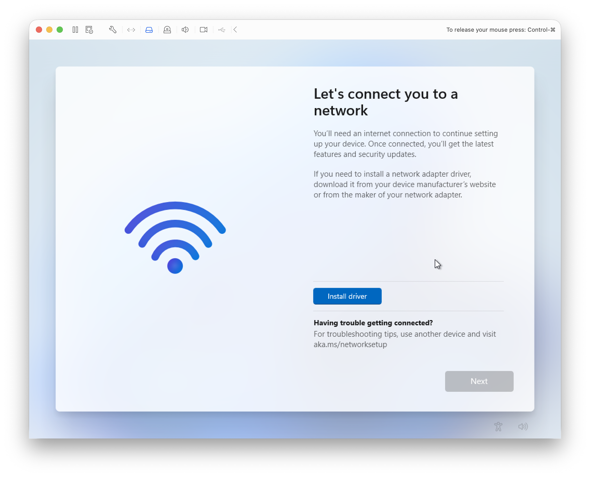

**Root cause:** The Windows installer does not include a driver for the VM's virtual network adapter, so setup could not get online.

**Fix:** **[FILL IN: what you actually did, for example bypassed the network requirement during setup, then installed VMware Tools from the Fusion menu]**

**Verification:** After setup, `ipconfig /all` shows a `vmxnet3 Ethernet Adapter` with `192.168.157.131/24`, gateway `192.168.157.2`, and a ping to the Ubuntu server returns 4/4 replies.

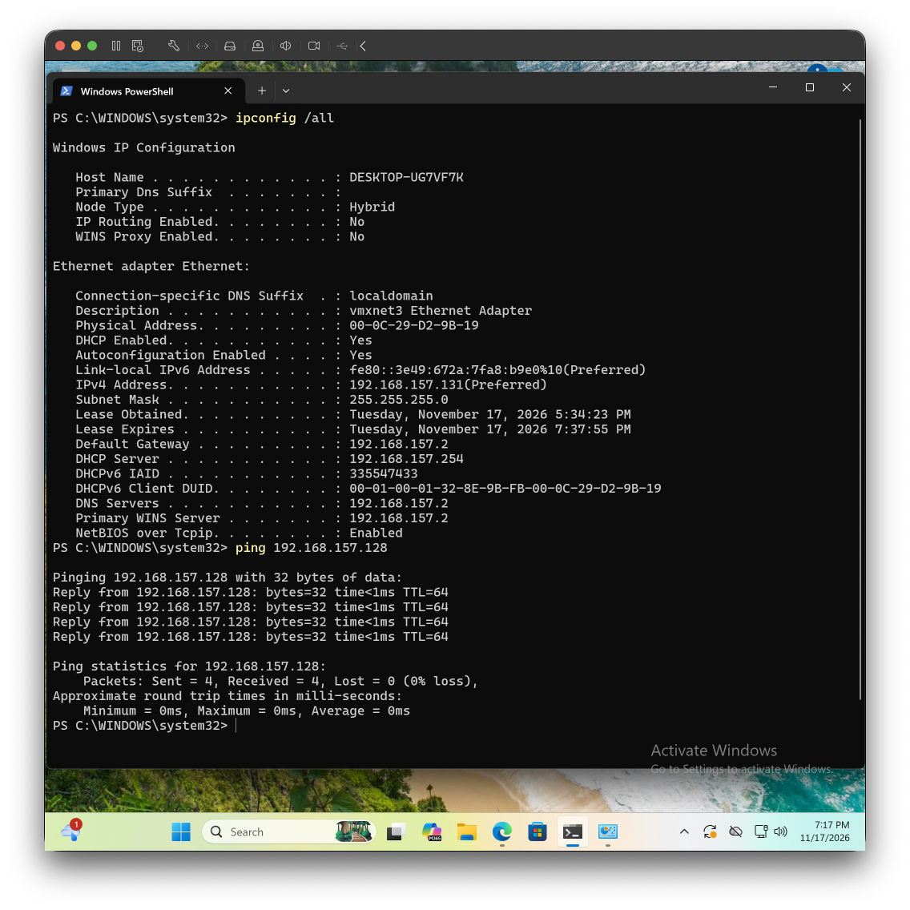

**Lesson:** A missing network driver in a VM is a guest-tools problem, not a network problem. Check the adapter in Fusion (NAT, connected) first, then the guest driver.

---

## Problem 2: Package install failed because the disk was full

**Symptom:** Installing Apache, PHP, and MySQL ended with `Errors were encountered while processing: mysql-server` and `Sub-process /usr/bin/dpkg returned an error code (1)`. `df -h /` showed the root filesystem at **100%** with 15 MB available.

**Diagnosis:** The error message names the failing package, and `df -h /` explained why it failed: the 9.8 GB root volume was out of space, so MySQL's post-install configuration could not complete. The terminal prompt (`PS /home/admin1>`) also showed I was in PowerShell rather than bash, which I corrected before continuing.

**Root cause:** Ubuntu's default LVM layout gave the root logical volume only part of the virtual disk.

**Fix:**
1. Extended the logical volume with the space already free in the volume group (`lvextend -r`), growing the root filesystem to 17 GB.
2. Grew the partition into the unused disk space with `growpart /dev/nvme0n1 3`.
3. Told LVM about the larger partition with `pvresize /dev/nvme0n1p3`. My first attempt mistyped the name as `/dev/nvme01p3` and failed with `device not found`; I rechecked the device name and reran it correctly.
4. Extended the logical volume and filesystem again with `lvextend -r -l +100%FREE /dev/ubuntu-vg/ubuntu-lv`.

**Verification:** `df -h /` now shows 37 GB total, 27 GB available, 25% used, and the MySQL installation completed (`mysqld` appears in the listening-ports output).

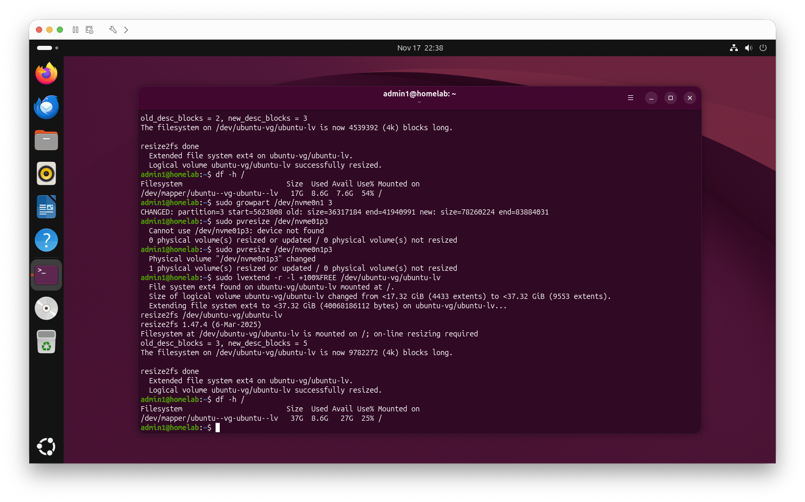

**Lesson:** Check `df -h /` before installing large packages, and do not assume the installer used the whole disk. When a command fails with `device not found`, verify the device name before trying anything else.

---

## Problem 3: System state "degraded"

**Symptom:** `systemctl status` reported `State: degraded` with `Failed: 2 units`.

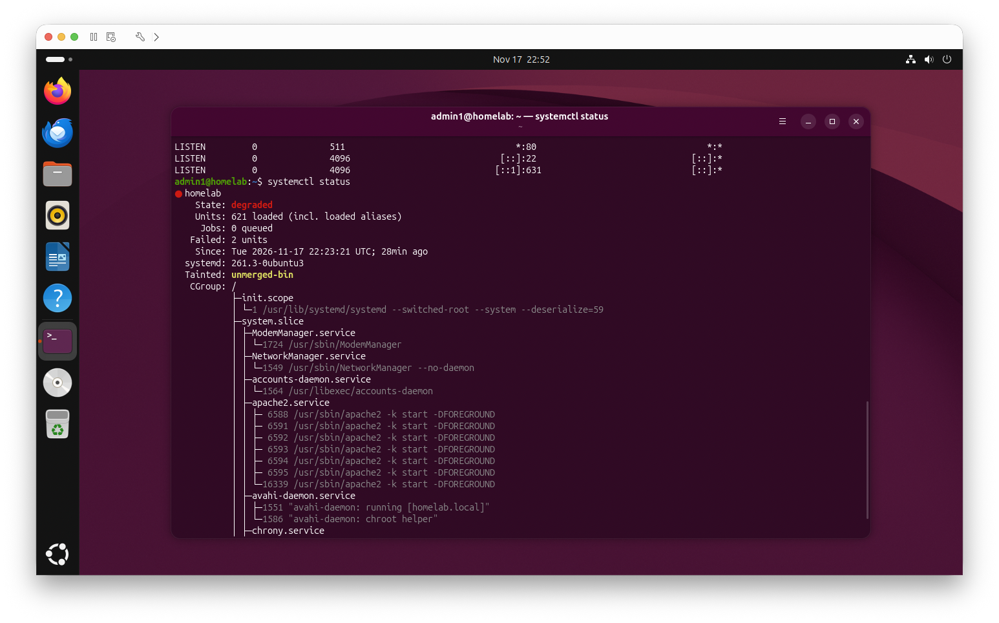

**Diagnosis:** `systemctl --failed` identifies the failed units. They were **`dnsmasq`** and **`apparmor`**. These were not part of the osTicket build: a half-configured MySQL install can also leave AppArmor reporting a failed profile, and `dnsmasq` is a DNS/DHCP service this lab does not use. **[FILL IN: the journalctl lines you saw for each unit]**

**Root cause:** **[FILL IN: for example, apparmor failed because of the interrupted MySQL install; dnsmasq was not needed and was conflicting with the system resolver]**

**Fix:** **[FILL IN: the commands you ran, for example reinstalling MySQL cleanly, restarting apparmor, and disabling dnsmasq]**

**Verification:** `systemctl status` now reports `State: running` and `Failed: 0 units`. Both screenshots show the same boot (`Since: Tue 2026-11-17 22:23:21 UTC`), so the fix did not require a reboot.

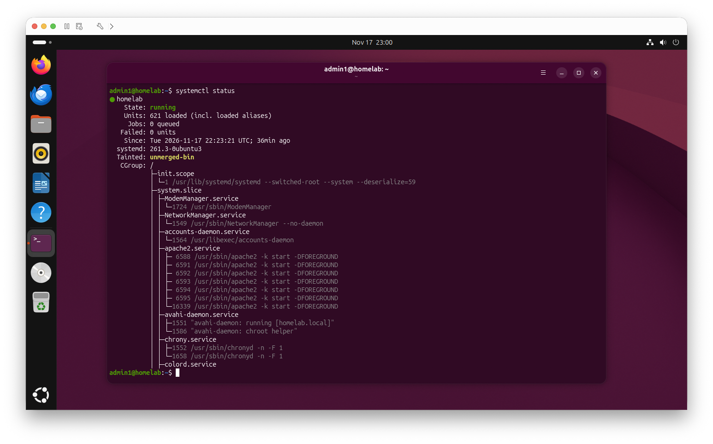

**Lesson:** "Degraded" is a summary. The useful command is `systemctl --failed`, followed by `journalctl -xeu <unit>` for the cause. Services that do not belong to the build should be disabled, not left failing.

---

## Problem 4: New MySQL account denied on the first login

**Symptom:** After creating the `osticket` database and user, the first login test returned `ERROR 1045 (28000): Access denied for user 'osticket'@'localhost' (using password: YES)`. The second attempt succeeded.

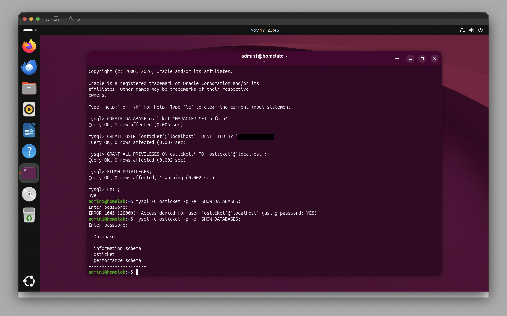

**Diagnosis:** Error 1045 means MySQL rejected the login for that account and host. The usual causes are a wrong password or a mismatched username or host, so the next step is to retry carefully with the exact credentials from the `CREATE USER` statement.

**Root cause:** **[FILL IN: for example, the password was mistyped on the first attempt]**

**Fix and verification:** Retried with the correct credentials. The successful login lists only `information_schema`, `performance_schema`, and `osticket`, which confirms the account can see only its own database plus MySQL's built-in schemas. The grant was `ALL PRIVILEGES ON osticket.*` for `'osticket'@'localhost'`, so the account cannot reach any other database and cannot connect from another machine.

**Lesson:** Test a new database account directly with the same credentials the application will use, before the installer depends on it. In the screenshot, the password is redacted; never commit real credentials.

---

## Problem 5: osTicket installer says "Configuration file missing"

**Symptom:** Opening `/osticket/setup/` showed **Configuration file missing!** and a **Continue** button that did nothing useful.

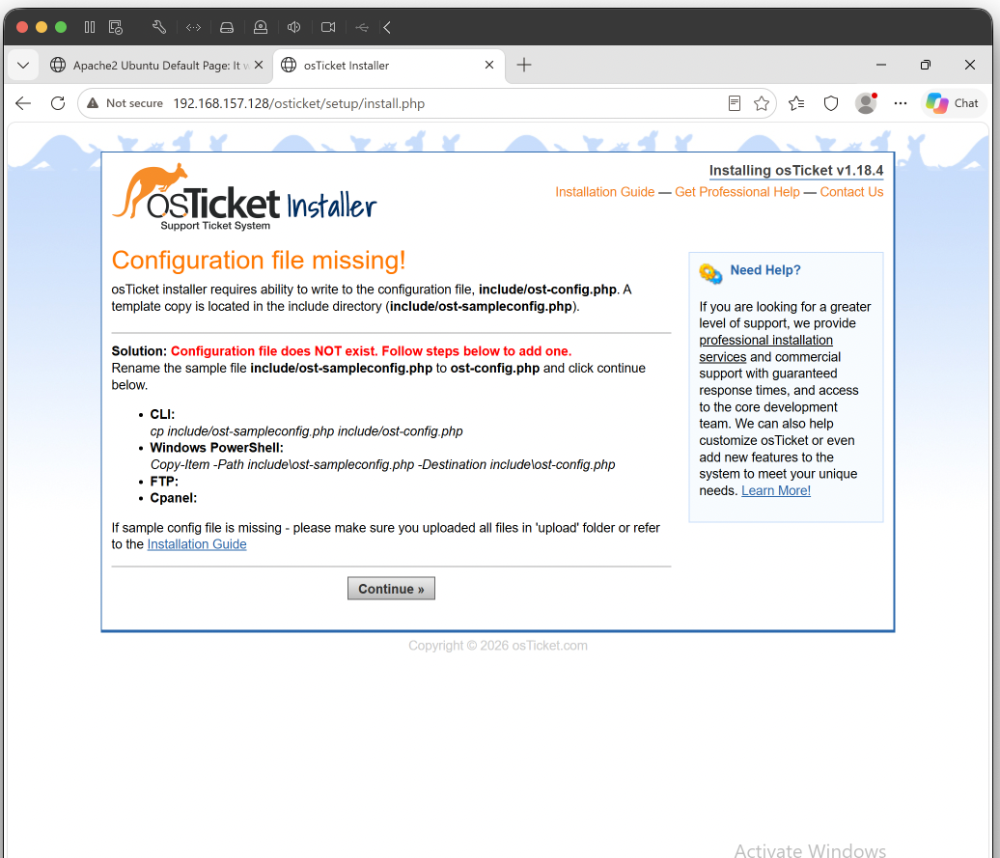

**Diagnosis:** The page states what it needs: `include/ost-config.php` must exist and be writable. Only `include/ost-sampleconfig.php` was present after copying the application files.

**Root cause:** The working config file had not been created from the sample.

**Fix:** Created `ost-config.php` from `ost-sampleconfig.php` and made it temporarily writable for the installer, then continued the setup.

**Verification:** The installer completed and showed the success page with the portal and staff control panel links.

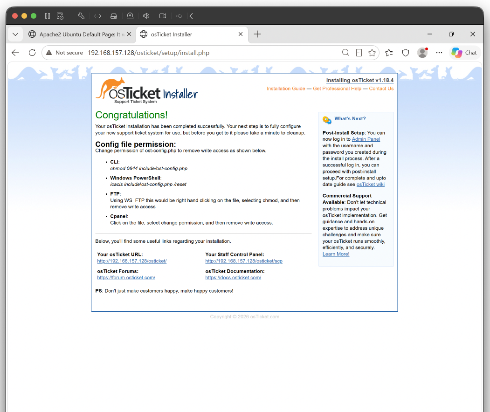

**Lesson:** Installer error pages usually spell out the fix. The write permission is only needed during install, which is why the config file is locked down immediately afterward (see the README hardening table).

---

## Problem 6: World-writable web root, then 403 Forbidden after hardening

### Finding

A permissions audit of the web root showed the directory itself was **`drwxrwxrwx` (777)**. Anyone who can log in to the system could add or replace files in that folder, and Apache would serve or execute them. For a PHP application, that is how a web shell gets planted.

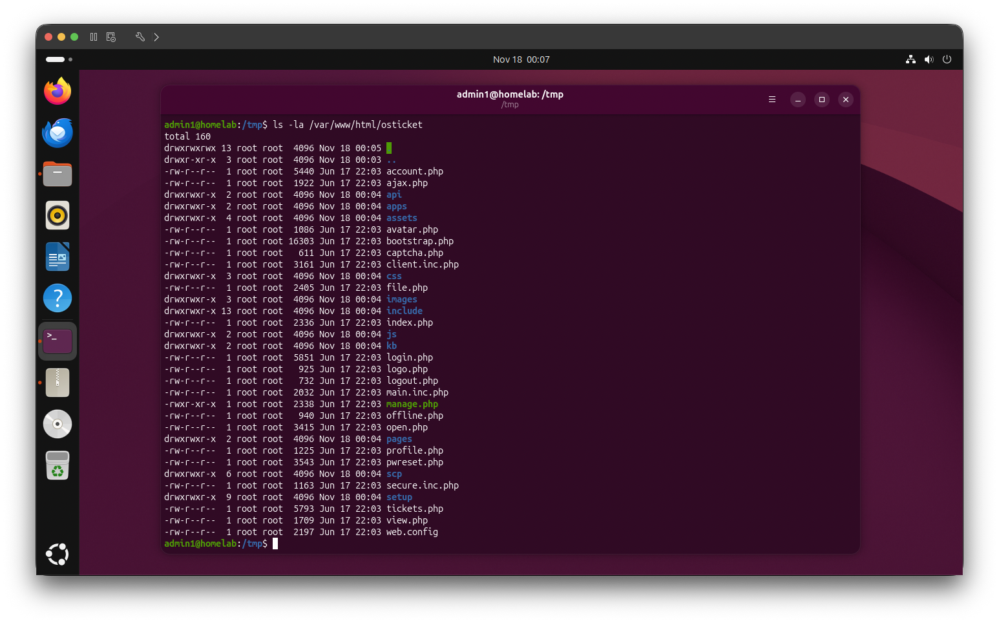

### What went wrong

I tightened permissions with two `find` commands. The first correctly set directories to 755. The second was meant to set **files** to 644, but I typed `-type d` instead of `-type f`, so it applied 644 to every **directory**. Directories need the execute bit to be entered, so the web root became `drw-r--r--`.

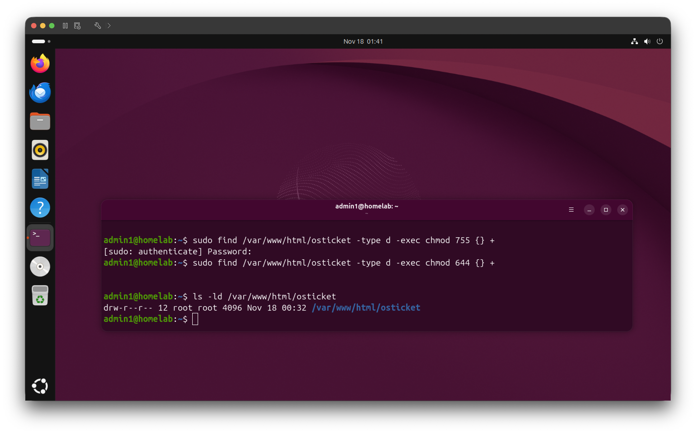

### Symptom

Apache returned **403 Forbidden** for the staff control panel (and the portal) at `192.168.157.128/osticket/scp/`.

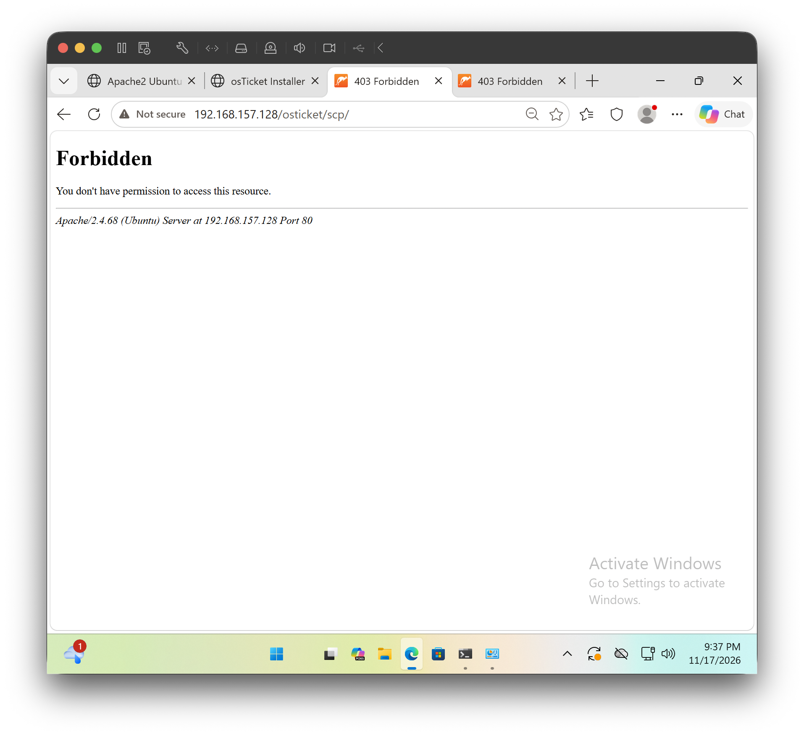

### Diagnosis

`namei -l /var/www/html/osticket/index.php` prints the permissions of every directory from `/` down to the file. Every parent directory was `drwxr-xr-x`, but `osticket` showed `drw-r--r--`, and the file lookup ended with **`index.php - Permission denied`**. That pinpoints the broken directory.

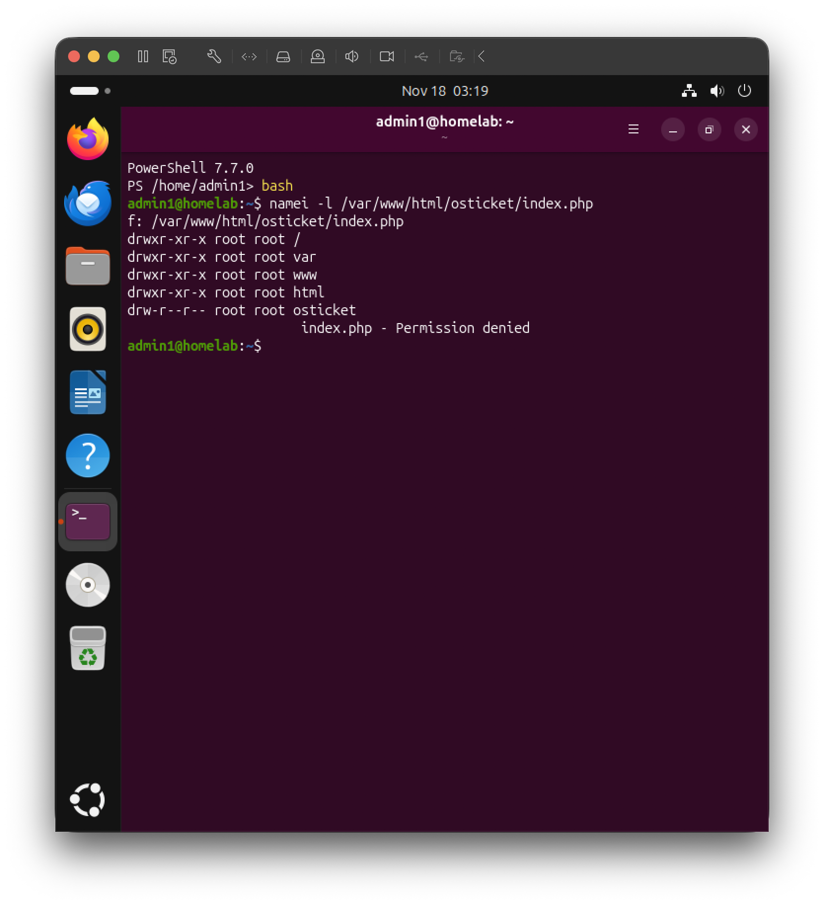

### Root cause

A `chmod 644` was applied to directories. A directory's execute (`x`) bit controls whether anything beneath it can be reached, so with `x` removed, Apache could not traverse into the application folder even though the files inside were readable.

### Fix

Reapplied the correct modes separately: **755 for directories** (`find ... -type d`) and **644 for files** (`find ... -type f`), then restarted Apache.

### Verification

The web root is now `drwxr-xr-x` (755) instead of the original 777, and the portal loads again. The browser tab title for the staff panel is back to "osTicket :: Agent".

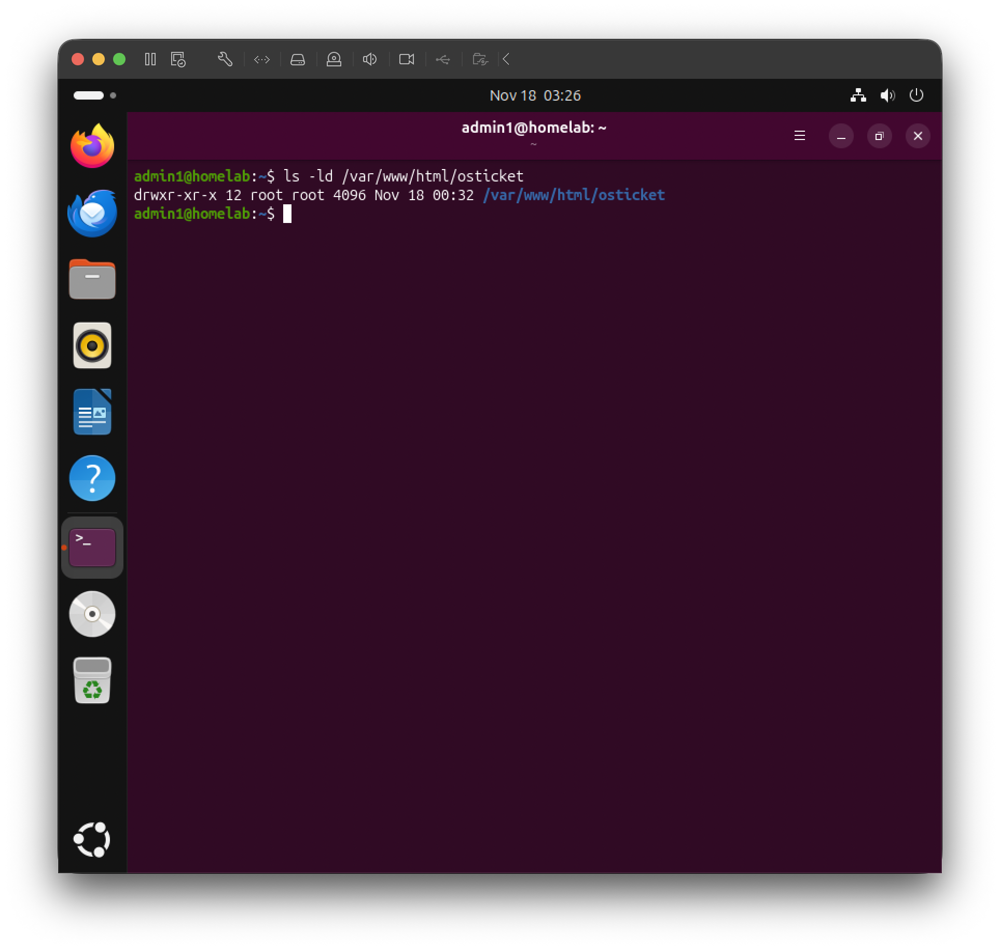

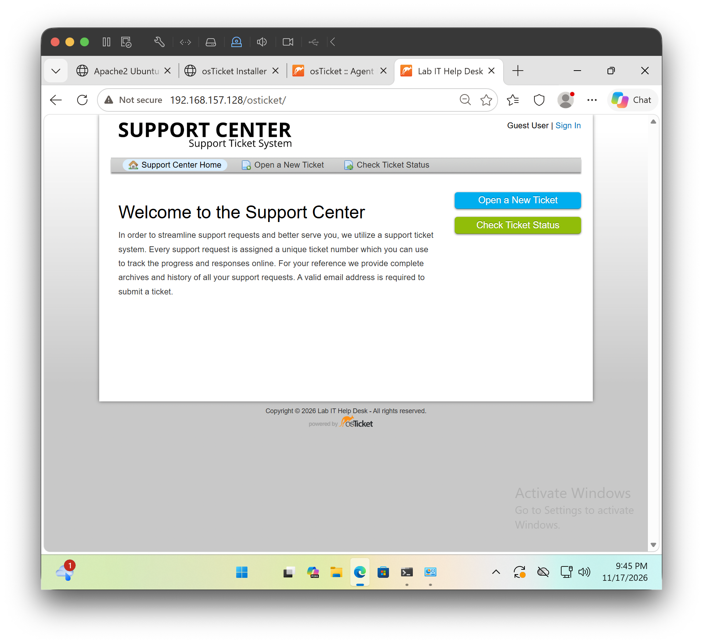

### Lesson

- 777 on a web directory is a real vulnerability; the correct pattern is 755 for directories and 644 for files, with the application owner kept separate from the web server user.
- Apply file and directory modes in **separate commands** and double-check the `-type` flag before pressing Enter.
- Test immediately after a permission change, and keep a VM snapshot so a mistake is a quick rollback.
- When access breaks after a change, trace the whole path with `namei -l` instead of guessing which folder is wrong.

---

## Observation (not a fault): ping from Ubuntu to Windows times out

From the Ubuntu server, `ping 192.168.157.131` shows 100% packet loss, while the Windows VM can ping the server with 0% loss and TTL 64 (a Linux host). Both are on the same subnet and gateway, so routing is fine. The likely explanation is that Windows Defender Firewall blocks inbound ICMP echo by default. Testing from the Windows client to the server is the direction that matters for a help desk portal. To confirm, I could allow ICMPv4 echo on Windows and retest, which would make a good future ticket scenario.

Evidence: see the Ubuntu and Windows connectivity screenshots in the main [README](../README.md#1-virtual-network).
